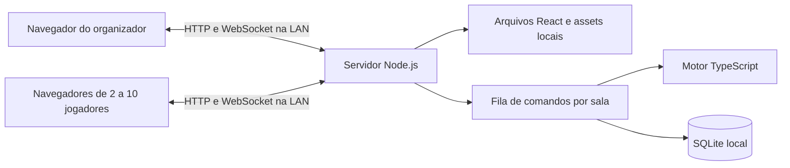

# Poker Table — auditoria técnica e plano de desenvolvimento

Data: 31/10/2026. Escopo: inspeção, execução de verificações e planejamento; nenhuma funcionalidade implementada e nenhum arquivo versionado dos projetos de referência alterado.

**Recomendação: iniciar uma base própria em TypeScript, com servidor Node.js autoritativo na LAN.** O PocketPoker fornece referências úteis de interface e decomposição do domínio, mas exige correções importantes no motor, substituição da rede e construção de persistência. Além disso, não foi encontrada licença que autorize sua incorporação. A decisão pode ser revista se houver autorização de reutilização e se o custo de corrigir os defeitos abaixo se mostrar menor que implementar o recorte do produto.

O TableChips é uma referência mais sólida para hospedagem local: seu código contém servidor HTTP/WebSocket, cliente web empacotado, recuperação e serviço Android. Não é um motor de Texas Hold'em com turnos automáticos, e seu código é GPLv3.

## 1. Escopo, versões e método

O diretório de trabalho fornecido estava vazio de código de aplicação. Foram clonadas cópias independentes em `/tmp/poker-audit-20261031`, preservando o workspace para o relatório.

| Projeto | Commit auditado | Data do commit |
|---|---|---|
| PocketPoker | `7ae65c8c89e28afed8d899141ae34b93226b900f` | 19/05/2026 |
| TableChips | `f877424f02f685d76c0eae8df0ee9d621b5c6e7c` | 30/10/2026 |

As referências de código neste documento estão fixadas nesses commits. Mudanças posteriores não estão cobertas. Não foram encontrados arquivos `AGENTS.md` nos checkouts.

Foram usados quatro níveis de evidência: inspeção estática; testes originais executados; sondagens externas que importam o código original; e experimento com o build de produção em navegador. Afirmações dos READMEs não foram tomadas como comprovação. As sondagens ficaram fora dos checkouts e suas cópias textuais acompanham as evidências.

Ambiente: Linux, Node.js 22.22.1, npm 10.9.4 obtido via Corepack em `/tmp`, Chrome 156.0.8078.47 e OpenJDK 25.0.4.1. O wrapper do TableChips baixou Gradle 9.7.1. Sem Android SDK ou dispositivos físicos disponíveis.

## 2. Diagnóstico do PocketPoker

### Organização e arquitetura real

| Área | Implementação encontrada | Implicação |
|---|---|---|
| `src/engine` | Tipos, estado inicial, reducer `applyAction`, fases, potes, baralho e avaliação de mãos | Boa separação de React e rede; motor pequeno e testável isoladamente |
| `src/net` | `Host`, `Client`, adaptador `Room`, schemas Zod, TURN e helper de migração | Autoridade no navegador do anfitrião; não existe servidor persistente |
| `src/session` | Contexto React cria Host/Client e entrega estado à UI | Acoplamento entre ciclo de vida da interface e autoridade da partida |
| `src/ui` | Lobby, configuração, entrada, espera, mesa, resumo, ações e controles do dealer | Componentes móveis aproveitáveis conceitualmente; integração pouco testada |
| `src/router.tsx` | Navegação em memória por enumeração de telas | Reload não restaura uma sessão ativa |
| `src/lib` | UUID, diagnóstico e polyfill parcial de SubtleCrypto | Adaptação para HTTP; não elimina dependências de sinalização |
| `public` | Ícones e endpoints/configuração TURN, inclusive arquivos PHP | Material de hospedagem externa não necessário no produto LAN |
| `tests` | 14 arquivos Vitest, jsdom e Testing Library | Cobertura funcional concentrada no motor e em helpers |

Fontes: [árvore de código](https://github.com/k1bot2026/PocketPoker/tree/7ae65c8c89e28afed8d899141ae34b93226b900f/src), [configuração do projeto](https://github.com/k1bot2026/PocketPoker/blob/7ae65c8c89e28afed8d899141ae34b93226b900f/package.json).

O estado canônico é um `GameState` em memória dentro de `Host`. Os participantes enviam ações; o host aplica o reducer e transmite snapshots. Para cartas virtuais, remove o baralho e cartas alheias do estado público e envia cartas privadas. O dealer remoto recebe um snapshot completo para uma tentativa de migração. A interface do próprio host usa `applyLocalAction`, um caminho diferente do protocolo remoto.

O reducer retorna novos objetos na maioria das transições e não importa React ou DOM. Entretanto, não é determinístico em todos os caminhos: `startHand` usa `Date.now()` por padrão e o embaralhamento usa aleatoriedade. Uma eventual reprodução por eventos precisa de tempo/aleatoriedade explícitos; no produto com cartas físicas, o baralho virtual pode ficar fora do escopo.

### Salas, identidade, validação e recuperação

- Sala identificada por código de seis caracteres; QR gerado localmente com `location.origin/?join=...`. O código identifica a sala, não descobre o IP do host.
- Adaptador usa **`@trystero-p2p/mqtt`**, apesar de comentários ainda mencionarem BitTorrent. O host não fornece `relayUrls` locais; entram os brokers públicos padrão da biblioteca.
- `peerToPlayerId` liga conexão e jogador, mas o próprio cliente escolhe o `player.id` no `join`, sem segredo de sessão. Assim, essa associação não autentica o jogador.
- Zod valida a forma de diversas mensagens; `state` e `snapshot` usam `z.any()`. Não há versão de protocolo, versão de estado, identificador idempotente de comando nem confirmação durável.
- Há checagem de turno, saldo, check diante de aposta, raise mínimo e permissões do dealer. Faltam invariantes globais e há conflitos entre identificação do autor e do alvo de comandos administrativos.
- `localStorage` guarda perfil; `sessionStorage` guarda configuração pendente e código de entrada. Não foi encontrado armazenamento do estado da mão, histórico durável, banco, journal ou restauração da partida após reinício do host.
- A reconexão reapresenta identidade e recebe estado, mas não limpa `disconnected`. A migração mantém snapshots apenas em memória; não substitui persistência.

Fontes: [host](https://github.com/k1bot2026/PocketPoker/blob/7ae65c8c89e28afed8d899141ae34b93226b900f/src/net/host.ts), [cliente](https://github.com/k1bot2026/PocketPoker/blob/7ae65c8c89e28afed8d899141ae34b93226b900f/src/net/client.ts), [protocolo](https://github.com/k1bot2026/PocketPoker/blob/7ae65c8c89e28afed8d899141ae34b93226b900f/src/net/protocol.ts), [sessão React](https://github.com/k1bot2026/PocketPoker/blob/7ae65c8c89e28afed8d899141ae34b93226b900f/src/session/GameSession.tsx).

### Dependências

O lockfile instalou React/React DOM 19.2.5, Zod 4.3.6, qrcode 1.5.4, pokersolver 2.1.4, Trystero e seu transporte MQTT 0.23.0, `@noble/ciphers` 2.2.0 e `@noble/hashes` 1.8.0. A ferramenta de build é Vite 8.0.8; testes usam Vitest 4.1.4; TypeScript 6.0.2; PWA usa vite-plugin-pwa 1.2.0/Workbox.

As nove dependências diretas de produção estão declaradas como MIT no lockfile. Isso não licencia o código próprio nem comprova a procedência dos assets. A auditoria não fez análise completa de vulnerabilidades e licenças transitivas.

Dependências de execução externas identificadas: brokers MQTT públicos; STUN padrão Google/Cloudflare; TURN configurável por `/turn.php` ou `/turn.json`; Google Fonts importado em `src/style/global.css`. React, Zod, qrcode e o motor podem funcionar empacotados localmente; não exigem acesso à internet por natureza. Instalação/build podem exigir internet na preparação, que deve ser separada da operação de uma partida.

## 3. Funcionalidades comprovadas versus requisitos

“Parcial” significa que existe código, mas há defeito, limite ou falta de comprovação relevante para a V1.

| Requisito V1 | Estado no PocketPoker | Evidência/limite |
|---|---|---|
| Texas Hold'em com cartas físicas | Parcial | Modo `assistant` dispensa cartas digitais; pagamentos e all-ins têm falhas críticas |
| 2–10 jogadores | Não atende | UI aceita 2–8; host não impõe `maxPlayers`; não há validação de mesa de dez |
| Criar sala LAN sem internet | Não atende | Criação local existe, mas entrada depende da sinalização externa |
| Entrada pelo navegador e QR | Implementado, com limite | QR usa a origem atual; precisa ser endereço acessível aos convidados |
| Mesa visual e posições | Parcial | Assentos, dealer e blinds visíveis; oponentes em faixa horizontal; sem reordenação de lugares físicos ou validação para dez |
| Dealer/SB/BB | Parcial | Postagem e heads-up básico testados; casos de eliminação, short blinds e sit-out exigem revisão |
| Turnos automáticos | Parcial | Há turnIndex e fechamento de rodada; raise e all-in revelaram bloqueios |
| Fases da mão | Parcial | Preflop/flop/turn/river/showdown; assistant pula fases de distribuição sem confirmação física |
| Fold/check/call/bet/raise/all-in | Parcial | Todos existem; validação e reabertura de ação incompletas |
| Pote principal e secundários | Parcial | `buildPots` tem testes positivos; fluxo manual não respeita os potes calculados |
| Distribuição manual por pote | Não atende | Uma lista global de vencedores recebe a soma dos potes |
| Atualizações em tempo real | Implementação existente | Broadcast P2P; não comprovado em partida completa entre celulares nesta auditoria |
| Persistência local da partida | Ausente | Apenas perfil/configuração; estado do jogo em memória |
| Reconexão e recuperação | Parcial e defeituoso | Rejoin não restaura presença; sem recuperação após perda do host |
| Sem operações financeiras | Compatível com recorte | Há modo visual “money” e rebuy de fichas; não foi encontrada integração de depósitos/pagamentos. A V1 deve manter somente unidades de fichas |

Fontes: [configuração 2–8](https://github.com/k1bot2026/PocketPoker/blob/7ae65c8c89e28afed8d899141ae34b93226b900f/src/ui/screens/HostSetup.tsx#L107), [controles do dealer](https://github.com/k1bot2026/PocketPoker/blob/7ae65c8c89e28afed8d899141ae34b93226b900f/src/ui/dealer/DealerInline.tsx), [potes](https://github.com/k1bot2026/PocketPoker/blob/7ae65c8c89e28afed8d899141ae34b93226b900f/src/engine/pots.ts), [mesa](https://github.com/k1bot2026/PocketPoker/blob/7ae65c8c89e28afed8d899141ae34b93226b900f/src/ui/table/OtherPlayers.tsx).

## 4. Verificação técnica executada

### PocketPoker

| Verificação | Resultado | Classificação |
|---|---|---|
| Clone inicial no sandbox | DNS de GitHub indisponível; clone realizado com acesso de rede autorizado | Restrição do ambiente, resolvida |
| `npm` no PATH | Ausente; caminho global aparente também não continha CLI utilizável; npm 10.9.4 obtido via Corepack em `/tmp` | Configuração do ambiente, resolvida |
| `npm ci` | Falhou com `ERESOLVE` | Conflito preexistente de peer dependencies |
| `npm ci --legacy-peer-deps` | Instalou 606 pacotes sem alterar manifest/lockfile | Exceção diagnóstica; não é correção proposta |
| `npm test` | **91/91 passaram, 14 arquivos**, 5,66 s | Suíte original |
| `npm run typecheck` | Passou: `tsc --noEmit` | Verificação configurada para `src` e `tests` |
| `npm run lint` | Código de saída zero | Resultado insuficiente: configuração somente para JS/JSX |
| ESLint sobre `src/engine/actions.ts` | Aviso “File ignored because no matching configuration was supplied” | Lacuna preexistente comprovada |
| `npm run build` | Passou; bundle JS 786,81 kB, gzip 235,47 kB; service worker gerado | Não executa TypeScript automaticamente |
| Sondagens externas | **14/14 confirmaram comportamentos problemáticos** | Não pertencem à suíte original; sucesso indica reprodução do defeito |
| Integração web/rede original | Não encontrada | Há integração entre funções do motor, não teste Host↔Client ou E2E |

O conflito é específico: `vite-plugin-pwa@1.2.0` declara suporte a Vite até a série 7, enquanto o lockfile contém Vite 8.0.8. O build passou apesar disso; não equivale a uma combinação oficialmente suportada. O Node disponível satisfaz a exigência do Vite (`^20.19.0 || >=22.12.0`), mais restrita que o “Node 20+” do README. Também houve avisos de dependências depreciadas, bundle acima de 500 kB e base Browserslist antiga.

Logs completos: [instalação padrão](evidencias/install.log), [instalação diagnóstica](evidencias/install-legacy.log), [testes](evidencias/test.log), [TypeScript](evidencias/typecheck.log), [lint](evidencias/lint.log), [build](evidencias/build.log), [sondagens](evidencias/probes.log).

### Qualidade e cobertura dos testes

A distribuição é: 62 testes de engine, 18 de schemas/helper de migração, 7 de UI, 3 de haptic e 1 smoke aritmético. Há bons exemplos de heads-up inicial, calls curtos, divisão de contribuições em side pots, avaliação de mãos e transições básicas.

Contudo, os 18 testes de rede não testam `Host` nem `Client`; a migração verifica apenas se o ID corresponde ao dealer do snapshot. Os sete testes de UI se limitam a Button e CardSelector. Não há testes de persistência, reconexão real, acessibilidade, fluxo completo de sala, dez jogadores ou execução sem internet.

Há teste que **consolida um comportamento incorreto**: depois de um raise e dos calls dos adversários, exige um check adicional do próprio raiser para fechar a rodada. O teste de pagamento manual percorre uma situação simples e não confronta elegibilidade por side pot. Alguns testes manipulam o estado diretamente ou usam assertions fracas/condicionais.

Não foi medida cobertura percentual de linhas/branches: não há provedor de cobertura instalado/configurado. Não se adicionou dependência só para gerar uma porcentagem. O inventário funcional e as reproduções demonstram lacunas concretas; 91 testes verdes não certificam as regras de poker. Fontes: [suíte original](https://github.com/k1bot2026/PocketPoker/tree/7ae65c8c89e28afed8d899141ae34b93226b900f/tests), [teste que exige check extra](https://github.com/k1bot2026/PocketPoker/blob/7ae65c8c89e28afed8d899141ae34b93226b900f/tests/engine/phases.test.ts#L169).

### Experimento de operação offline

O build foi servido em `http://127.0.0.1:18083`, com dois contextos novos e isolados do Chrome. DNS externo foi bloqueado no navegador, mantendo loopback disponível. Foram criados host e convidado para a mesma sala; aguardaram-se 35 segundos após a tentativa de entrada.

**Resultado:** host permaneceu com um jogador, botão de início desabilitado; convidado permaneceu em “Connecting…”. O navegador tentou WebSockets para `test.mosquitto.org`, `broker.emqx.io`, `broker-cn.emqx.io` e `public.cloud.shiftr.io`; foram registrados 93 erros de WebSocket por resolução de nome. O shell da aplicação carregou localmente, mas os participantes não se encontraram.

Isso comprova a dependência externa do caminho atual de entrada em uma sala nova. Não mede uma conexão WebRTC estabelecida antes da queda da internet. Também não simula um Wi-Fi físico: loopback é contexto potencialmente confiável e não equivale a HTTP em IP LAN. O resultado não depende de presumir que todo WebRTC exige internet; WebRTC pode usar sinalização local, mas esta aplicação não a configura.

Evidências: [resumo do navegador](evidencias/offline-browser-summary.json), [script do experimento](evidencias/offline-browser.mjs.txt), [adaptador Room](https://github.com/k1bot2026/PocketPoker/blob/7ae65c8c89e28afed8d899141ae34b93226b900f/src/net/room.ts), [fontes externas](https://github.com/k1bot2026/PocketPoker/blob/7ae65c8c89e28afed8d899141ae34b93226b900f/src/style/global.css#L2).

## 5. Defeitos e limitações prioritários

As referências P01–P14 correspondem às [sondagens reproduzíveis](evidencias/audit.test.ts.txt). Elas verificam o comportamento observado, deliberadamente sem corrigir o motor. Os testes de rede usam um `Room` em memória e não alegam exercitar WebRTC real.

| Prioridade | Achado e reprodução | Consequência |
|---|---|---|
| Bloqueador | **P04:** contribuições 50/200/200 geram potes 150 e 300; declarar o jogador de 50 vencedor entrega 450 a ele | Distribuição manual viola elegibilidade de side pots |
| Bloqueador | **P02:** A all-in 50, B e C call; mesmo alternando checks, rodada não termina, pois o último ator esperado é A all-in | Partida bloqueada em cenário comum |
| Bloqueador | **P03:** três jogadores all-in no assistant deixam estado em `FLOP_BETTING`, sem jogador acionável; `advance-phase` não resolve | Não chega ao showdown manual |
| Alta | **P01:** A raise 60, B call, C call; turno volta a A para um check adicional | Fluxo de apostas incorreto; teste original aceita esse erro |
| Alta | **P07:** A raise 60, B all-in 70, C call; A pode raise 110 | Raise curto reabre ação de quem já agiu sem aumento completo |
| Alta | **P08:** jogador com stack 15 envia `raise 15` diante de BB 20; `currentBet` cai para 15 | Invariante de aposta vigente quebrada |
| Alta | **P05:** declarar ID inexistente remove potes sem creditar um jogador | Destruição de fichas; IDs e elegibilidade não validados no pagamento |
| Alta | **P06:** `bet` aceito em `WAITING` se coincidir com turnIndex | Fase é protegida pela UI, insuficientemente pelo motor |
| Alta | **P09:** dealer tenta `resume-player` para outro jogador; host rejeita porque `playerId` do alvo não é o autor | Controles administrativos não cumprem sua função; mesma ordem de guards afeta fold/kick direcionados |
| Alta | **P10:** jogador sai e faz rejoin com o mesmo ID; continua `disconnected=true` | Reconexão não recupera participação automaticamente |
| Alta | **P11:** conexão entra usando ID do host e consegue executar sua ação | Identidade pública não é credencial; apropriação de assento |
| Alta | **P13/P14:** schema aceita estado arbitrário e Client aceita `state` de peer diferente do host | Estado recebido não é validado nem autenticado como autoritativo |
| Média | **P12:** capacidade configurada não é imposta pelo host | Sala pode exceder limite; UI também não admite 9–10 |

Fontes principais: [ações](https://github.com/k1bot2026/PocketPoker/blob/7ae65c8c89e28afed8d899141ae34b93226b900f/src/engine/actions.ts#L24), [fechamento da rodada](https://github.com/k1bot2026/PocketPoker/blob/7ae65c8c89e28afed8d899141ae34b93226b900f/src/engine/phases.ts#L125), [pagamento manual](https://github.com/k1bot2026/PocketPoker/blob/7ae65c8c89e28afed8d899141ae34b93226b900f/src/engine/phases.ts#L343), [guards do host](https://github.com/k1bot2026/PocketPoker/blob/7ae65c8c89e28afed8d899141ae34b93226b900f/src/net/host.ts#L244).

Outros achados por inspeção, sem reprodução ponta a ponta:

- **Migração:** `onHostMigration` cria `Host.fromSnapshot` e muda `currentRole`; o efeito dependente dessa variável cria depois outro `new Host`, sem restaurar o snapshot. Além disso, `fromSnapshot` repõe a lista na ordem original, mas `applyLocalAction` identifica o jogador local por `lobbyPlayers[0]`. Não há teste do ciclo React ou handshake que demonstre migração funcional.
- **Snapshot sem confirmação/época:** envio ao dealer não tem acknowledgment, versão ou eleição que impeça autoridade duplicada após partição. Se dealer e host forem a mesma pessoa, não há cópia remota naquele momento.
- **Sit-out:** o fechamento considera jogadores vivos com filtros diferentes de `isRoundClosed`; jogadores fora da mão podem impedir a vitória automática após folds. `sit-out/leave` não são limitados a intervalos de mão.
- **Ficha indivisível:** ordenação para distribuir sobras atribui distância zero ao dealer; se ele estiver entre os empatados pode receber a sobra antes de quem está à esquerda. Requer teste e regra explícita.
- **Validação:** entradas locais não passam pelo mesmo schema remoto; não há limites seguros uniformes para inteiros, unicidade de vencedores, fase e condição ativa. Os guards de turno não excluem explicitamente all-in/sit-out/desconectado.
- **Acessibilidade:** Sheet usa `role=dialog` e Escape, mas não implementa foco inicial, contenção/restauração de foco ou associação do título. Não há avaliação de leitor de tela/contraste; texto diminui progressivamente em mesas grandes. O botão escolhido para vencedor usa `data-selected`, sem estado acessível equivalente.

Para as regras de side pots, sobras e reabertura de ação, há referência normativa útil nas regras TDA 2026, especialmente itens 21, 23 e 47. Usá-las como especificação seletiva do motor exige definir as regras da mesa doméstica, sem adotar automaticamente todas as regras de torneio presencial. [Fonte TDA](https://www.pokertda.com/view-poker-tda-rules/).

## 6. TableChips: arquitetura offline, testes e licença

### O que está no código

| Componente | Decisão encontrada | Utilidade para Poker Table |
|---|---|---|
| `core` | Kotlin puro; comandos, eventos, regras e restauração do ledger | Domínio separado de Android e transporte |
| `server/TableServer.kt` | Ktor/CIO em `0.0.0.0`, HTTP e WS; porta 8080 com alternativas | Um host serve interface e comunicação na mesma origem |
| Recursos `web/` | HTML/JS e fontes empacotados; servidos do classpath | Convidados não precisam instalação, cache prévio ou CDN |
| Rotas | `/`, `/join`, `/qr.svg`, `/health`, `/ws` e `/echo` | Entrada por QR e diagnóstico de conectividade local |
| `NetworkAddresses.kt` | Enumera IPv4, exclui interfaces móveis e prioriza interfaces de hotspot | Não fixa `192.168.43.1`; apresenta alternativas de endereço |
| `TableHost.kt` | Mutex serializa comandos e enfileira broadcasts; atribui autor a partir da conexão | Uma autoridade e ordem consistente de processamento |
| Cliente web | WebSocket na mesma origem, identidade local e reconexão com espera crescente de 0,5 a 5 s | Reconexão faz parte do produto, não só do transporte |
| `HostService.kt` | Serviço Android em primeiro plano, notificação, `START_STICKY`, retomada quando intent é nulo | Trata o ciclo de vida móvel explicitamente |
| `FileLedgerStore.kt` | JSON com eventos, arquivo temporário e rename | Persistência existe; não é SQLite |
| Host nativo | Interface local comunica-se pelo mesmo protocolo dos convidados | Evita divergência entre ação local e remota |

Fontes: [servidor](https://github.com/tablechips/tablechips/blob/f877424f02f685d76c0eae8df0ee9d621b5c6e7c/server/src/main/kotlin/io/github/tablechips/server/TableServer.kt), [serialização de comandos](https://github.com/tablechips/tablechips/blob/f877424f02f685d76c0eae8df0ee9d621b5c6e7c/server/src/main/kotlin/io/github/tablechips/server/TableHost.kt), [serviço Android](https://github.com/tablechips/tablechips/blob/f877424f02f685d76c0eae8df0ee9d621b5c6e7c/app/src/main/kotlin/io/github/tablechips/app/HostService.kt), [armazenamento](https://github.com/tablechips/tablechips/blob/f877424f02f685d76c0eae8df0ee9d621b5c6e7c/app/src/main/kotlin/io/github/tablechips/app/FileLedgerStore.kt), [cliente web](https://github.com/tablechips/tablechips/blob/f877424f02f685d76c0eae8df0ee9d621b5c6e7c/server/src/main/resources/web/index.html).

O hotspot é ativado pelo usuário; o servidor não cria uma rede automaticamente. O código detecta endereços e serve clientes nessa rede. Uma permissão Android chamada `INTERNET` é necessária para sockets, mas sua presença não significa dependência de WAN.

Limitações a não reproduzir: erros de gravação são silenciados em `FileLedgerStore.save` e `TableHost`; a interface pode confirmar estado que não chegou ao disco. O fallback de rename chega a apagar o arquivo antigo, e `load` limpa armazenamento inválido. Portanto, a afirmação de durabilidade não é absoluta. Identidade trazida pelo cliente também não é um segredo de retomada: o novo projeto deve distinguir ID público de credencial.

O poker do TableChips possui blinds, button, contribuições e potes, mas **não modela quem deve agir a cada momento**. A finalidade é assistência manual à mesa. Logo, não satisfaz diretamente nosso requisito de turnos e fases automáticos. [Protocolo e escopo do poker](https://github.com/tablechips/tablechips/blob/f877424f02f685d76c0eae8df0ee9d621b5c6e7c/docs/protocol.md).

### Verificações realizadas

`./gradlew :core:test :server:test --no-daemon`, com cache isolado: **125/125 testes de core passaram; 56/57 testes de server passaram**. O build de testes falhou em `OrderingTest`, por timeout de 10 s esperando quatro jogadores sentados (`OrderingTest.kt:48–49`), antes da verificação final de ordenação. A repetição isolada também falhou por timeout.

Classificação: falha observada em checkout original, reproduzida neste ambiente; causa-raiz não determinada. Não prova que o servidor enviou revisões fora de ordem, nem autoriza classificar automaticamente como mero problema de ambiente. Há concorrência no teste e ele deve ser investigado antes de tomar a suíte inteira como verde.

Os testes que passaram incluem servidor HTTP/WS real em loopback, envio dos recursos web, QR, protocolo e recuperação com ledger serializado. O SDK ausente fez o Gradle omitir `:app`; não foram executados build APK, testes Robolectric, serviço Android real ou testes de hotspot com iPhone/Android. Não há demonstração nesta auditoria de uma partida física completa do TableChips com WAN desligada.

Evidências: [execução completa](evidencias/tablechips-tests.log), [repetição isolada](evidencias/tablechips-ordering-retry.log), [teste HTTP/WS](https://github.com/tablechips/tablechips/blob/f877424f02f685d76c0eae8df0ee9d621b5c6e7c/server/src/test/kotlin/io/github/tablechips/server/TableServerTest.kt), [teste de ordenação](https://github.com/tablechips/tablechips/blob/f877424f02f685d76c0eae8df0ee9d621b5c6e7c/server/src/test/kotlin/io/github/tablechips/server/OrderingTest.kt).

### Licenças e condições de reaproveitamento

**PocketPoker:** não foi localizado `LICENSE`, `COPYING`, `NOTICE`, declaração equivalente no README, nem campo `license` no package.json do commit auditado. `private: true` impede publicação npm acidental, mas não concede licença. Repositório público e dependências MIT não autorizam assumir que o projeto é MIT. Reutilização/distribuição de código ou assets deve aguardar licença ou autorização explícita dos titulares. A documentação do GitHub descreve a ausência de licença como manutenção dos direitos padrão do autor. [Orientação do GitHub](https://docs.github.com/en/repositories/managing-your-repositorys-settings-and-features/customizing-your-repository/licensing-a-repository).

**TableChips:** `NOTICE` declara GNU GPL versão 3; `LICENSE` contém o texto integral. Incorporar ou portar código para uma obra derivada distribuída exige avaliar compatibilidade e cumprir GPLv3, incluindo avisos e disponibilização do código-fonte correspondente nos casos aplicáveis. Não basta renomear ou traduzir Kotlin para TypeScript. A obrigação concreta depende da forma de incorporação/distribuição; estudo de arquitetura e implementação independente de requisitos não equivalem automaticamente a copiar código. Não foi copiado código do TableChips para PocketPoker ou para uma aplicação nova nesta etapa. [LICENSE](https://github.com/tablechips/tablechips/blob/f877424f02f685d76c0eae8df0ee9d621b5c6e7c/LICENSE), [NOTICE e fontes OFL](https://github.com/tablechips/tablechips/blob/f877424f02f685d76c0eae8df0ee9d621b5c6e7c/NOTICE).

## 7. Arquitetura LAN proposta e reaproveitamento

### Topologia recomendada



Um processo Node.js serve o build React e o WebSocket pela mesma origem. A V1 usa um único host por sala e armazenamento em disco local; sem banco remoto, Redis, autenticação externa ou eleição entre celulares. O servidor pode hospedar um registro de salas, mas a primeira homologação deve ser uma mesa ativa por host. O organizador usa o mesmo protocolo dos outros jogadores.

**Host inicial recomendado:** computador, mini-PC ou equipamento equivalente com Node empacotado e ligado à rede Wi-Fi. Os participantes precisam apenas do navegador. Isso atende ao requisito atual, que não exige hospedagem em um telefone. Se Android como único host for obrigatório na V1, a escolha da base deve ser reavaliada antes de implementar: Node não vem no Android, e empacotamento, serviço em primeiro plano e armazenamento nativo tornam-se parte crítica. Termux pode ajudar num experimento técnico, mas não deve ser pressuposto como experiência final de uso.

### WebSocket ou Socket.IO

| Opção | Ganho | Trabalho que continua necessário |
|---|---|---|
| WebSocket no servidor e API nativa do navegador | Protocolo pequeno, sem cliente adicional, suficiente para dez conexões | Reconexão, heartbeat, identidade, schemas, versão e confirmação de comandos |
| Socket.IO | Reconexão, rooms e acknowledgments prontos; reduz trabalho de transporte | Persistência, idempotência, autenticação de assento e recuperação após reinício continuam sendo da aplicação |

**Preferência inicial: WebSocket com uma biblioteca de servidor mantida, sem framework de tempo real adicional.** Fazer uma prova curta de perda/reconexão antes de consolidar a decisão. Socket.IO é alternativa válida se reduzir custo real para a equipe; o cliente deve ser empacotado localmente. Sua garantia padrão é entrega no máximo uma vez e a recuperação de conexão pode falhar; não é solução de durabilidade por si só. [Garantias de entrega](https://socket.io/docs/v4/delivery-guarantees/), [recuperação](https://socket.io/docs/v4/connection-state-recovery/).

Manter WebRTC com broker/sinalização local seria tecnicamente possível, porém adiciona negociação de peers, ICE e autoridade no navegador sem necessidade para mensagens pequenas. A substituição por servidor local é uma reestruturação da sessão e das garantias de entrega, não só troca de uma chamada de biblioteca.

### Contrato, autoridade e persistência

- Comandos propostos: versão do protocolo, `roomId`, `commandId`, `handId`, `expectedVersion`, tipo e payload. O servidor deriva o autor da sessão autenticada; `targetPlayerId` é campo separado quando necessário.
- `roomId/playerId` são públicos; segredo aleatório de retomada é emitido pelo servidor, armazenado no cliente e verificado no host. Código de sala/QR não dá privilégio de organizador. Definir política para duas abas do mesmo jogador e troca de aparelho.
- Uma fila por sala serializa comandos. Antes de executar, checar duplicação de `commandId`; para comando já confirmado, devolver o resultado anterior. Só então validar versão, fase, turno, permissões e valores.
- Calcular novo estado e gravar **estado, versão, evento e resultado do comando na mesma transação SQLite**. Só após commit publicar snapshot e confirmar sucesso. Falha de disco impede confirmação e pausa ações; não continuar silenciosamente.
- Armazenar valores inteiros de fichas, com limites de segurança; evitar ponto flutuante. Conservar `soma dos stacks + fichas comprometidas ainda não distribuídas`. Potes são projeções dessas contribuições e não devem ser contados uma segunda vez.
- Uma tabela de snapshots versionados e um log append-only simplificam recuperação e diagnóstico. Não é necessário começar com event sourcing completo; validar versão do schema e invariantes ao carregar.
- Presença de rede é efêmera e distinta de fold/sit-out. Ao reiniciar, restaurar a mão e considerar conexões ausentes até o rejoin. Ao reconectar, enviar snapshot completo com versão e confirmar comandos pendentes; nunca repetir aposta cegamente.
- Potes têm identidade, valor, elegíveis e situação de liquidação. Dealer seleciona vencedor(es) **por pote**. Rejeitar IDs repetidos/inexistentes/ineligíveis; devolver aposta não coberta; tratar empate/sobra; impedir pagamento duplo.

SQLite é adequado a um escritor local e transações pequenas. WAL, nível de sincronização, checkpoints, backup e comportamento de disco cheio devem ser homologados com o driver escolhido. Não colocar o arquivo em pasta de rede nem supor que rename equivale a persistência confirmada. [Atomicidade SQLite](https://www.sqlite.org/atomiccommit.html).

### Endereço local, QR e operação sem internet

Expor `http://<IP-LAN>:<porta>/join/<sala>`, listando interfaces e a porta efetiva; não gerar QR com `localhost`. Exibir endereço textual e instrução para conectar à mesma rede. QR gerado no host e lido pela câmera do sistema não requer acesso à câmera dentro do site.

Todos os arquivos necessários — scripts, CSS, fontes, ícones e biblioteca de QR — devem acompanhar o host. O acesso inicial de um navegador sem cache deve funcionar com WAN e dados móveis desligados. Service worker é opcional: não é requisito para uma aplicação servida localmente, e HTTP em IP privado normalmente não permite seu registro. A exceção de localhost não se estende a outros celulares na LAN. [Service Worker API](https://developer.mozilla.org/en-US/docs/Web/API/Service_Worker_API).

HTTP/WS local é uma escolha viável para a primeira homologação em rede confiável, mas não oferece confidencialidade contra quem controla a rede. Não prometer criptografia ponta a ponta. Validar Origin, tamanho/frequência de mensagens e credenciais; impedir elevação de papel. HTTPS local exige uma estratégia de certificados confiáveis, decisão separada. Firewall, isolamento de clientes no roteador, VPN e mudança de IP precisam de diagnóstico visível.

### O que reaproveitar

| Item PocketPoker | Potencial técnico | Condição |
|---|---|---|
| Tipos de domínio e separação engine/net/ui | Alto como referência | Reescrever no projeto próprio; copiar somente após licença |
| `buildPots` | Pequeno algoritmo útil | Testar entradas, refunds e elegibilidade; autorização antes de incorporar |
| Motor completo | Baixo para adoção direta | Corrigir fechamento, all-ins, reabertura, fases e pagamento antes de uso |
| Componentes de perfil, mesa, ações, QR, toasts | Médio | Revisar acessibilidade, posições, 10 jogadores e direitos de assets |
| Schemas Zod e fronteira `Room` | Ideia reutilizável | Contrato novo, com autenticação, versões e idempotência |
| Testes existentes | Referência de cenários | Não copiar expectativas incorretas; autorização para reutilizar arquivos |
| Host/Client/migração P2P | Baixo | Substituir pelo serviço autoritativo e cliente de sessão LAN |
| Baralho/pokersolver/TURN/polyfill | Fora do recorte V1 | Não necessários para cartas físicas e WebSocket local |

## 8. Estrutura proposta e roteiro com aceitação

Estrutura enxuta proposta, ainda não criada:

```text
apps/
  server/                 # HTTP, WebSocket, salas, sessões, SQLite
  web/                    # React, navegação e interface móvel
packages/
  engine/                 # regras, estado e transições sem I/O
  protocol/               # schemas e tipos dos comandos/respostas
tests/
  integration/            # servidor real e banco temporário
  e2e/                    # navegadores, reconexão e operação sem WAN
docs/
  decisions/              # regras da mesa, transporte e hospedagem
  operations/             # iniciar host, rede, backup e recuperação
```

Começar com workspaces simples, sem orquestrador de monorepo. Bibliotecas só quando houver função concreta: React/build, schemas, servidor WebSocket e driver SQLite. O runtime, lockfile e procedimento de instalação precisam ser fixados; o pacote de operação não deve executar `npm install` a cada partida.

| Etapa | Entrega | Testes e critérios de aceitação |
|---|---|---|
| **0 — decisão e especificação** | Registrar base própria, licença do projeto, host inicial, regras de no-limit, empate/sobra, saída e reconexão | Matriz de exemplos para 2, 3 e 10 jogadores; critérios abaixo aprovados antes de desenvolver motor; nenhuma incorporação sem licença |
| **1 — viabilidade LAN** | Servidor local serve tela mínima e protocolo versionado; IP/QR e dez conexões | Em rede sem WAN, dois telefones com cache vazio abrem por IP/QR; dez clientes se conectam; zero requisições externas; TypeScript/lint/build válidos; cliente desconhecido não assume assento alheio |
| **2 — motor independente** | Estado de mão, posições, blinds, ordem de ação, streets, ações legais e potes | Testes de mesa e propriedades para 2–10; igualdade de saldo total, inteiros não negativos, estado anterior imutável, nenhuma rodada bloqueada; todos os cenários P01–P08 com resultado correto |
| **3 — comandos duráveis** | Fila autoritativa por sala, SQLite, snapshots/versionamento e deduplicação | Clientes enviam comandos concorrentes; versão cresce monotonicamente; comando repetido produz um único débito; versão antiga é rejeitada; matar processo antes/depois do commit resulta em zero ou uma aplicação; falha de disco não recebe ACK de sucesso |
| **4 — retomada de sessão** | Token de jogador, heartbeat, reconexão, recuperação após reinício e política de conflito | Fechar/reabrir aba, alternar Wi-Fi, bloquear tela e reiniciar servidor preservam assento/stack/turno; ACK perdido não duplica ação; credencial errada é recusada; perda de storage tem recuperação controlada pelo organizador |
| **5 — mesa móvel e pagamento** | Visualização de posições físicas, dealer/blinds, ações legais, controle das fases e seleção por pote | Fluxo completo com 2, 6 e 10 jogadores; exemplo 50/200/200 paga 150 e 300 separadamente; empates, sobras, folds e refunds; duplo clique não paga duas vezes; teclado, TalkBack/VoiceOver, foco e zoom 200%; telas de 320–430 px sem perder ações essenciais |
| **6 — homologação e distribuição** | Pacote offline, documentação de rede/backup, recuperação de erro e identificação da versão | Partida real com Android e iPhone, roteador sem WAN e dados móveis desativados; ensaio de 2 horas, reconexões e restart; assets sem cache; captura sem tráfego externo da aplicação; stacks/potes consistentes em todos os dispositivos; instalação e partida sem downloads em runtime |

Etapas 2–4 devem ser exercitadas por um cliente de teste simples; não esperar a interface final para descobrir falhas de durabilidade. A aplicação não deve ser considerada pronta para partidas ao fim da etapa 1.

Casos obrigatórios do motor: heads-up antes/depois do flop; opção do BB; fold até um sobrevivente; blinds com stack insuficiente; all-in de abertura e de call; aumento completo versus curto; aumentos curtos acumulados; múltiplos side pots; jogador que desiste contribuindo para pote; sobra de empate à esquerda do botão; aposta não coberta devolvida; saída/sit-out/eliminações; transição de três para dois; pagamento de cada pote exatamente uma vez. Definir quem ainda deve responder à rodada e quem pode aumentar separadamente; um único “último ator” não representa bem todos esses casos.

Se, após licença, for escolhida a adaptação, inserir antes da etapa 1 uma etapa de caracterização: corrigir a instalação reproduzível e ESLint TS, incorporar testes de regressão independentes e testar Host/Client por injeção de transporte. Só então alterar o motor. O inventário atual já deixa claro onde a suíte original não protege o comportamento.

## 9. Riscos e decisões pendentes

| Decisão/risco | Proposta inicial | O que falta validar |
|---|---|---|
| Quem hospeda | Node em computador/mini-PC | Se o usuário exigir Android como único host, decidir isso antes do desenvolvimento |
| Licença PocketPoker | Não incorporar sem autorização | Obter licença explícita e verificar procedência dos assets, se houver interesse em adaptação |
| Política GPL | Referência arquitetural independente | Se houver derivação do TableChips, definir distribuição compatível e obrigações de fonte/avisos |
| Regras específicas | No-limit, fichas inteiras, pagamento por pote | Dead/moving button, entrada tardia, rebuy, sit-out e política de correção manual |
| Queda do host | Recuperar do SQLite no mesmo equipamento | Disponibilidade cessa enquanto host está desligado; failover automático fora da V1 |
| Queda do jogador | Preservar assento e pausar sua ação | Tempo de tolerância e intervenção do organizador; não transformar queda em fold automático sem regra explícita |
| IP/porta alterados | Regenerar QR e manter instrução textual | Storage do navegador depende da origem; mudança de IP pode exigir recuperação do assento por outro canal |
| Identidade em dois dispositivos | Um controlador ativo por assento | Substituição de conexão, papel de observador e recuperação sem token |
| HTTP local | Rede confiável na homologação | Modelo de ameaça e eventual HTTPS; IP privado não significa comunicação protegida |
| Persistência | Commit antes de ACK/broadcast | Driver, modo SQLite, disco cheio, backup e corrupção sem apagamento silencioso |
| Celulares | Interface responsiva e conexão recuperável | Suspensão de abas, bateria, Wi-Fi sem internet e diferenças Safari/Chrome |
| Evolução do schema | Estado e protocolo versionados | Migração de banco e impedir atualização inesperada no meio de uma mão |

Acessibilidade deve ser critério de aceitação: áreas de toque adequadas (meta de 44 CSS px), estados comunicados por texto além de cor, nome/estado acessível dos controles, foco visível, modais operáveis por teclado, anúncio moderado de turno/reconexão e respeito a movimento reduzido. Não há homologação WCAG realizada nesta etapa.

## 10. Decisão fundamentada e limites da conclusão

| Critério | Adaptar PocketPoker | Base própria TS/Node |
|---|---|---|
| Permissão de reutilização | Não demonstrada | Controlável desde a origem |
| Interface inicial | Já existe, com revisão necessária | Precisa ser construída |
| Motor correto para o recorte | Funções úteis, mas defeitos centrais comprovados | Implementação necessária, especificada pelos casos encontrados |
| LAN sem serviços externos | Transporte/sessão precisam substituição | Pode ser premissa desde a primeira etapa |
| Persistência e reconexão durável | Praticamente novas | Novas, com modelo consistente desde o início |
| Complexidade fora da V1 | Modos virtuais, torneio, money, TURN e migração | Pode limitar-se a cartas físicas e fichas |
| Risco de falsa confiança | Alto: testes verdes com expectativas incorretas | Exige testes desde o começo, sem herdar esses comportamentos |

**Decisão recomendada: base própria, mantendo PocketPoker como referência de experiência e TableChips como referência de hospedagem.** Não é uma conclusão de que reescrever seja sempre mais barato: neste recorte, quase toda a infraestrutura que precisamos falta ou deve mudar, enquanto o benefício principal do reaproveitamento — motor validado — não se confirmou. A falta de licença elimina a possibilidade de recomendar incorporação imediata com segurança razoável.

As primeiras entregas, após apresentação e escolha da direção, devem ser a especificação dos casos de poker e a prova de hospedagem LAN independente de internet. Depois, motor testável e processamento durável de comandos. Recursos de cartas virtuais, pagamentos, migração automática de host, torneios e instalação PWA não devem ampliar a primeira versão.

Permanecem sem verificação: partida completa do PocketPoker com rede externa disponível; comportamento WebRTC em celulares; migração real de host; cobertura percentual; auditoria completa de segurança/licenças transitivas; conteúdo e correspondência do ZIP de deploy com o source; build/execução Android do TableChips; causa do timeout de OrderingTest; funcionamento em roteadores/hotspots físicos; leitores de tela/contraste; recuperação após falta de energia real e funcionamento da arquitetura Node proposta, que ainda não foi implementada.

Essas limitações impedem certificar os projetos como prontos, mas não impedem escolher a base: há evidência suficiente para descartar adoção direta do PocketPoker e priorizar servidor LAN, regras corretas e durabilidade. **A implementação não foi iniciada.**
